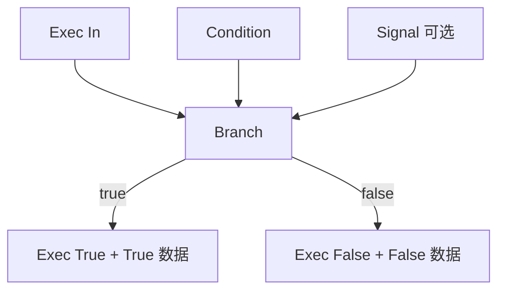

# Branch

| 字段 | 值 |
|---|---|
| 节点 ID | `flow.control.branch` |
| 分类 | `flow.control` |
| 显示名称 | Branch |
| 效果 | `PURE` |

## 作用

根据 **Condition**（严格布尔）把执行流（EXEC）分到 True / False 两条支路。可选的 **Signal** 只做透传（类型 `T`），**不会**挡住 EXEC 路由。

## 示意图



```text
  EXEC 脉冲 ──► 只走一条支路
  Signal 数据 ──► 同步出现在对应 True/False 口
```

## 端点

### 输入

| 显示名 | 端口 ID | 类型 | 说明 |
|---|---|---|---|
| Exec In | `exec_in` | EXEC | 上游执行脉冲 |
| Condition | `input_condition` | BOOLEAN | 分支条件；也可在属性面板里设默认值 |
| Signal | `input_signal` | ANY（透传 `T`） | 可选；随 True/False 支路一起带走的数据 |

### 输出

| 显示名 | 端口 ID | 类型 | 说明 |
|---|---|---|---|
| Exec True | `exec_true` | EXEC | Condition 为 true 时触发 |
| Exec False | `exec_false` | EXEC | Condition 为 false 时触发 |
| True | `output_true` | ANY（`T`） | Signal 在 true 支路的透传 |
| False | `output_false` | ANY（`T`） | Signal 在 false 支路的透传 |
| Valid | `output_valid` | BOOLEAN | Condition 预检是否通过 |
| Error | `output_error` | STRING | 未能分支时的原因 |

## 使用步骤

1. 把上游的 EXEC（例如 Manual Trigger 的 `Exec`）接到 **Exec In**。
2. 把布尔结果接到 **Condition**（可用 Compare / Boolean Toggle 等）。
3. 需要按支路带走同一份数据时，把该数据接到 **Signal**。
4. 将 **Exec True** / **Exec False** 分别接到后续要执行的节点。
5. 若下游需要数据，从 **True** / **False** 数据口继续连线。

## 典型接法

```text
[Manual Trigger].Exec ──► [Branch].Exec In
[Boolean Toggle].Out ──► [Branch].Condition
[某数据].Out         ──► [Branch].Signal

[Branch].Exec True ──► [Apply / 写入类节点].Exec
[Branch].Exec False ──► [Preview / 另一条逻辑].Exec
```

## 注意事项

- Condition 必须是严格 `BOOLEAN`；类型不对时看 **Valid** / **Error**。
- Signal 未连接时，EXEC 仍会按 Condition 正常分流。
- 同一时刻只有一条 EXEC 支路会亮（True 或 False），不会两边同时火。
