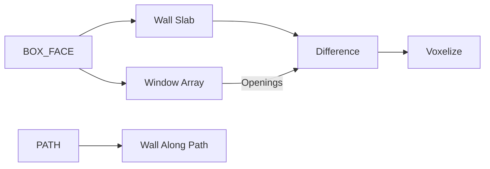

# geometry.architectural_primitives — 建筑原语

从 **BOX_FACE** 或 **PATH** 生成墙、窗洞切割体、柱网、楼板、屋顶、楼梯等。洞口节点输出的是**切割体**，需接到 [Difference](../boolean/difference.md) 才能从墙体挖空。

| 分组 | 教程 |
|---|---|
| 墙 / 楼板 | [wall_slab](./wall_slab.md) · [wall_with_openings](./wall_with_openings.md) · [wall_along_path](./wall_along_path.md) · [floor_slab](./floor_slab.md) |
| 洞口阵列 | [window_array](./window_array.md) · [door_array](./door_array.md) · [arch_opening](./arch_opening.md) · [window_frame](./window_frame.md) |
| 柱 / 梁 / 栏杆 | [column](./column.md) · [column_grid](./column_grid.md) · [beam_grid](./beam_grid.md) · [beam_along_path](./beam_along_path.md) · [railing](./railing.md) · [array_along_curve](./array_along_curve.md) |
| 屋顶 / 楼梯 / 装饰 | [roof_base](./roof_base.md) · [roof_generator](./roof_generator.md) · [staircase](./staircase.md) · [facade_panel_array](./facade_panel_array.md) · [pilaster_cornice](./pilaster_cornice.md) · [molding_profile](./molding_profile.md) |

进度见 [PROGRESS.md](../../PROGRESS.md)。
