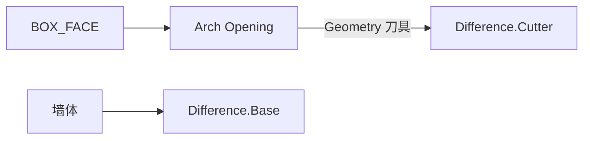

# Arch Opening

| 字段 | 值 |
|---|---|
| 节点 ID | `geometry.architectural_primitives.arch_opening` |
| 分类 | `geometry.architectural_primitives` |
| 显示名称 | Arch Opening |
| 效果 | `PURE` |

## 作用

拱门洞切割体：`rectangle` / `round` / `pointed`。总高 = Stem Height + 拱矢。

## 示意图



```text
  rectangle     round          pointed
  ┌────┐       ╭────╮         ╱╲
  │    │       │    │        ╱  ╲
  │    │       │    │        │  │
  └────┘       └────┘        └──┘
  ← Width →    Stem Height = 直壁段
  总高 = Stem + 拱矢（圆/尖拱）
```

与窗洞相同：输出是**切割体**，需 Difference 挖墙。

## 端点

| 方向 | 显示名 | 类型 |
|---|---|---|
| 入 | Face / Width / Stem Height / Depth / Arch Type / Segments | BOX_FACE / … |
| 出 | Geometry | GEOMETRY |
| 出 | Valid / Error | `output_valid` / `output_error` | BOOLEAN / STRING |

## 使用步骤

1. 按端点表接好构造/编辑所需输入。
2. 检查 Valid；Geometry / Path / Profile 等接到下游。

## 典型接法

```text
[上游].… ──► [Arch Opening].Face
[Arch Opening].Geometry ──► [下游].…
```
