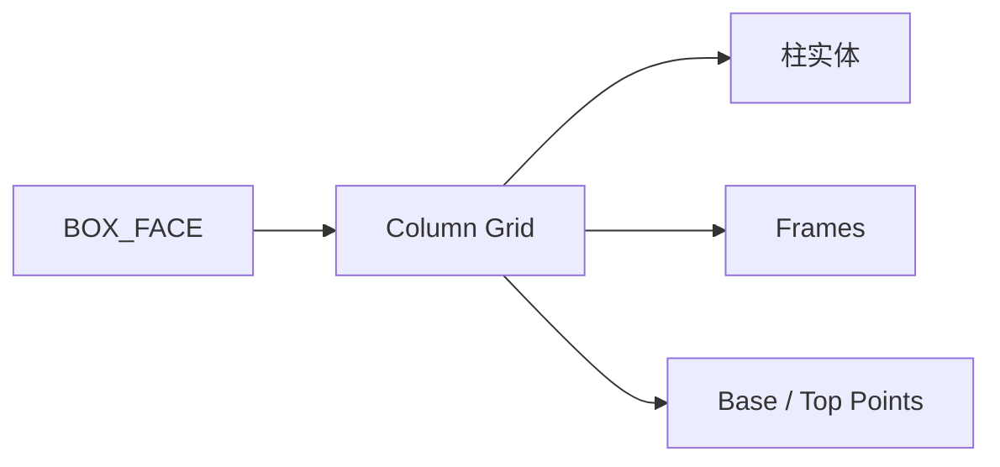

# Column Grid

| 字段 | 值 |
|---|---|
| 节点 ID | `geometry.architectural_primitives.column_grid` |
| 分类 | `geometry.architectural_primitives` |
| 显示名称 | Column Grid |
| 效果 | `PURE` |

## 作用

在面上生成矩形柱网：实体 + 基/顶点 + 放置 Frame。高度沿**面法线**。Shape：`cylinder` / `box` / `frustum`。

## 示意图



```text
  Face 平面上:
  ●───●───●   Columns × Rows
  │   │   │   Height ∥ 面法线（地板朝上时 = 世界 +Y）
  ●───●───●   Margin 缩进边缘
```

单柱用 [Column](./column.md)；沿路用 [Array Along Curve](./array_along_curve.md)。

## 端点

| 方向 | 显示名 | 类型 |
|---|---|---|
| 入 | Face / Columns / Rows / Radius / Height / Margin / Shape / Top Scale | … |
| 出 | Geometry / Frames / Base·Top Points / Indices / Count | … |
| 出 | Valid / Error | `output_valid` / `output_error` | BOOLEAN / STRING |

## 使用步骤

1. 按端点表接好构造/编辑所需输入。
2. 检查 Valid；Geometry / Path / Profile 等接到下游。

## 典型接法

```text
[上游].… ──► [Column Grid].Face
[Column Grid].Geometry ──► [下游].…
```
