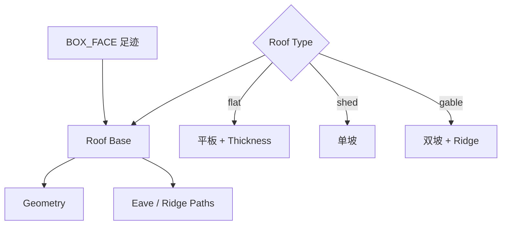

# Roof Base

| 字段 | 值 |
|---|---|
| 节点 ID | `geometry.architectural_primitives.roof_base` |
| 分类 | `geometry.architectural_primitives` |
| 显示名称 | Roof Base |
| 效果 | `PURE` |

## 作用

从盒体面足迹生成核心屋顶：`flat` / `shed` / `gable`。复杂造型优先用本节点；异形见 [Roof Generator](./roof_generator.md)。

## 示意图



```text
  flat          shed           gable
  ══════        ╱════          ╱╲
  足迹          足迹          ╱  ╲
  Overhang 外挑；Ridge Direction = 脊线沿 x 或 y
```

## 端点

| 方向 | 显示名 | 类型 |
|---|---|---|
| 入 | Face / Roof Type / Height / Thickness / Overhang / Ridge Direction / Eave Drop | … |
| 出 | Geometry / Primary Eave·Ridge Path / Eaves·Ridges·Valleys / Faces / Slope Directions | … |
| 出 | Valid / Error | `output_valid` / `output_error` | BOOLEAN / STRING |

## 使用步骤

1. 按端点表接好构造/编辑所需输入。
2. 检查 Valid；Geometry / Path / Profile 等接到下游。

## 典型接法

```text
[上游].… ──► [Roof Base].Face
[Roof Base].Geometry ──► [下游].…
```
