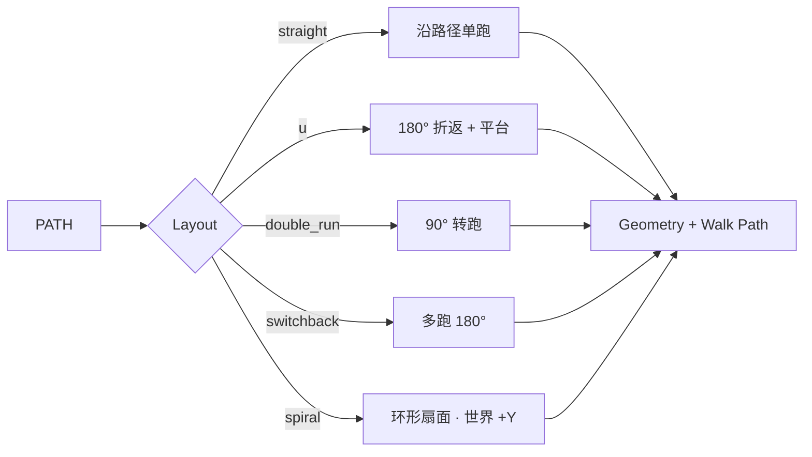

# Staircase

| 字段 | 值 |
|---|---|
| 节点 ID | `geometry.architectural_primitives.staircase` |
| 分类 | `geometry.architectural_primitives` |
| 显示名称 | Staircase |
| 效果 | `PURE` |

## 作用

楼梯：`straight` 跟 PATH；`u` = 180° 折返；`double_run` = 90° 转；`switchback` = 多跑 180°；`spiral` = 环形扇面踏步（高度沿世界 +Y）。

## 示意图



| Layout | Path 含义 | 关键参数 |
|---|---|---|
| straight | 走向 = 跑向 | Step Run / Rise / Width |
| u / switchback | 入口方向 | First Flight Steps / Landing / Turn* |
| double_run | 入口方向 | First Flight Steps / Turn Direction |
| spiral | 起点=轴基，方向=入口切向 | Spiral Radius / Turns / Height |

## 端点

| 方向 | 显示名 | 类型 |
|---|---|---|
| 入 | Path / Layout / Step Count / First Flight Steps / Step Run·Rise / Width | … |
| 入 | Landing Length / Turn Gap·Direction / Spiral* | … |
| 出 | Geometry / Step Frames·Centers / Walk Path / Bottom·Top / Rise·Run / Landing* / Count | … |
| 出 | Valid / Error | `output_valid` / `output_error` | BOOLEAN / STRING |

## 使用步骤

1. 按端点表接好构造/编辑所需输入。
2. 检查 Valid；Geometry / Path / Profile 等接到下游。

## 典型接法

```text
[上游].… ──► [Staircase].Path
[Staircase].Geometry ──► [下游].…
```

## 注意事项

- spiral 时 Path 起点作轴基点、方向作入口切向。
