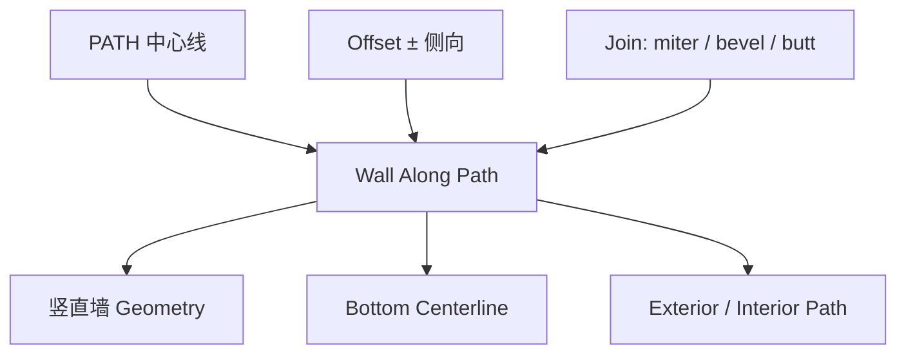

# Wall Along Path

| 字段 | 值 |
|---|---|
| 节点 ID | `geometry.architectural_primitives.wall_along_path` |
| 分类 | `geometry.architectural_primitives` |
| 显示名称 | Wall Along Path |
| 效果 | `PURE` |

## 作用

沿平面 XZ 路径挤竖直墙（高度沿世界 **+Y**，路径倾角不倾斜墙体）。Offset 解析底边中心线。

## 示意图



```text
       +Y 高度（世界竖直，不跟路径倾角）
        ▲
        ║████  Thickness
   ─────║████─────  XZ 路径（Offset 后底边）
        ║████
```

与 [Beam Along Path](./beam_along_path.md) 不同：墙始终竖立；梁跟路径局部坐标系。

## 端点

| 方向 | 显示名 | 类型 |
|---|---|---|
| 入 | Path / Height / Thickness / Offset / Join | PATH / DOUBLE / STRING |
| 出 | Geometry / Frames / Bottom Centerline / Center Line / Top·Exterior·Interior Path / Count | … |
| 出 | Valid / Error | `output_valid` / `output_error` | BOOLEAN / STRING |

## 使用步骤

1. 按端点表接好构造/编辑所需输入。
2. 检查 Valid；Geometry / Path / Profile 等接到下游。

## 典型接法

```text
[上游].… ──► [Wall Along Path].Path
[Wall Along Path].Geometry ──► [下游].…
```
