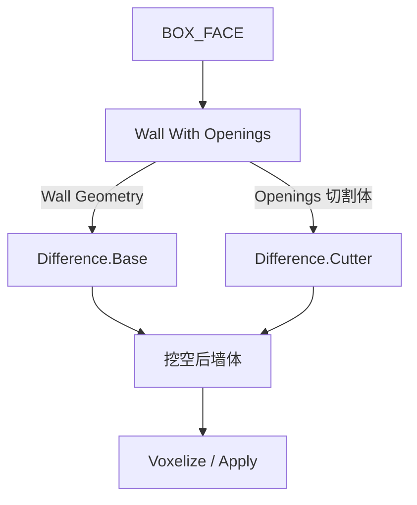

# Wall With Openings

| 字段 | 值 |
|---|---|
| 节点 ID | `geometry.architectural_primitives.wall_with_openings` |
| 分类 | `geometry.architectural_primitives` |
| 显示名称 | Wall With Openings |
| 效果 | `PURE` |

## 作用

一次输出**实心墙板** + **洞口切割体**（分开端口）。墙挖空：`Wall Geometry` + `Openings` → Difference。

## 示意图



洞口阵列是**刀具体积**，不会自动从墙里挖掉——必须接到 Difference。

## 端点

| 方向 | 显示名 | 类型 |
|---|---|---|
| 入 | Face / Columns / Rows / Wall Thickness / Opening Width·Height·Depth / Margin | … |
| 出 | Wall Geometry / Openings / Top·Bottom Edge / Center Line / Exterior·Interior Face / Count | … |
| 出 | Valid / Error | `output_valid` / `output_error` | BOOLEAN / STRING |

## 使用步骤

1. 接 Face（墙足迹）与 Columns / Rows / 洞口尺寸 / Wall Thickness。
2. 确认 Valid；把 **Wall Geometry** 与 **Openings** 分别接到 Difference。
3. Difference 结果再 Voxelize / Assign / Apply。

## 典型接法

```text
[Get Box Face].Face ──► [Wall With Openings].Face
[Wall With Openings].Wall Geometry ──► [Difference].Base
[Wall With Openings].Openings ──► [Difference].Cutter
[Difference].Geometry ──► [Voxelize] / [Apply Changes]
```
