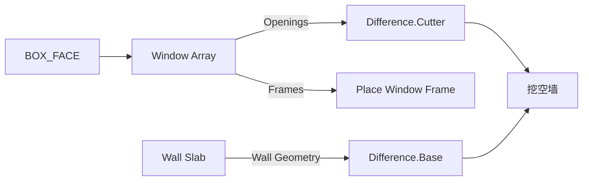

# Window Array

| 字段 | 值 |
|---|---|
| 节点 ID | `geometry.architectural_primitives.window_array` |
| 分类 | `geometry.architectural_primitives` |
| 显示名称 | Window Array |
| 效果 | `PURE` |

## 作用

在盒体面上生成矩形**窗洞切割体**阵列（非窗框实体）。`Layout Mode`：`distribute` / `fixed_gap` / `bay`。

## 示意图



```text
  ┌─────────────────────┐  Face
  │  ▢   ▢   ▢   ▢     │  distribute：均分余量
  │  ▢   ▢   ▢   ▢     │  fixed_gap：固定墩宽
  └─────────────────────┘  bay：按 Bay Width 开间
       Depth = 刀具厚度（沿法线 ±Depth/2）
```

Openings 是刀具；Frames 可挂 [Window Frame](./window_frame.md) 实体。

## 端点

| 方向 | 显示名 | 类型 |
|---|---|---|
| 入 | Face / Columns / Rows / Window Width·Height / Margin / Depth | BOX_FACE / INTEGER / DOUBLE |
| 入 | Layout Mode / Horizontal·Vertical Gap / Bay Width | STRING / DOUBLE |
| 出 | Openings / Frames / Centers / Row·Column Indices / Count | GEOMETRY / FRAME_LIST / … |
| 出 | Valid / Error | `output_valid` / `output_error` | BOOLEAN / STRING |

## 使用步骤

1. Face 接墙外立面；设 Columns/Rows、窗宽高、Margin、Depth。
2. 选 Layout Mode；fixed_gap / bay 时再接对应 Gap / Bay Width。
3. Openings → Difference.Cutter；可选 Frames → Place Geometry。

## 典型接法

```text
[Get Box Face].Face ──► [Window Array].Face
[Wall Slab].Wall Geometry ──► [Difference].Base
[Window Array].Openings ──► [Difference].Cutter
[Window Array].Frames ──► [Place Geometry On Frames].Frames
```
