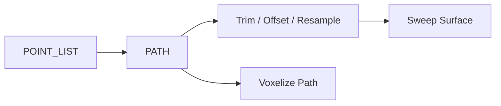

# geometry.curves — 路径与曲线

`PATH` 贯穿线/折线/采样曲线。可从点列、盒体面、样条构造，再修剪/偏移/求值，或直接体素化成管子。

| 分组 | 教程 |
|---|---|
| 构造 | [points_to_path](./points_to_path.md) · [arc](./arc.md) · [bezier](./bezier.md) · [interpolate_spline](./interpolate_spline.md) · [b_spline](./b_spline.md) · [nurbs](./nurbs.md) · [helix](./helix.md) · … |
| 编辑 | [join](./join_paths.md) · [trim](./trim_path.md) · [split](./split_path.md) · [extend](./extend_path.md) · [fillet](./fillet_polyline_corners.md) · [offset](./offset_curve_plane.md) · [resample](./resample_path.md) |
| 查询 | [path_length](./path_length.md) · [evaluate](./evaluate_curve.md) · [closest](./closest_point_on_path.md) |
| 派生 | [rainbow](./rainbow_curve_offset.md) · [blend](./blend_curves.md) · [tween](./tween_curves.md) · [voxelize](./voxelize_curve.md) |

进度见 [PROGRESS.md](../../PROGRESS.md)。
