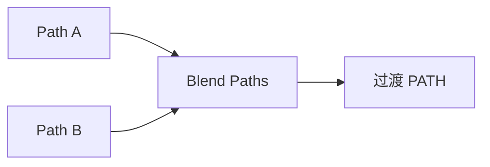

# Blend Paths

| 字段 | 值 |
|---|---|
| 节点 ID | `geometry.curves.blend_curves` |
| 分类 | `geometry.curves` |
| 显示名称 | Blend Paths |
| 效果 | `PURE` |

## 作用

在两路径端点之间用切线手柄生成平滑过渡路径。

## 示意图



```text
  Path A ──────●
                ╲  Length A/B = 手柄长度
                 ●═══●  Blend 段
                ╱
  Path B ●──────
```

Segments 控制过渡采样密度；常用于把两段路「圆滑接上」。

## 端点

| 方向 | 显示名 | 端口 ID | 类型 |
|---|---|---|---|
| 入 | Path A / B / Length A / Length B / Segments | … | … |
| 出 | Path / Points / Start Point / End Point | … | … |
| 出 | Valid / Error | `output_valid` / `output_error` | BOOLEAN / STRING |

## 使用步骤

1. 按端点表接好构造/编辑所需输入。
2. 检查 Valid；Geometry / Path / Profile 等接到下游。

## 典型接法

```text
[上游].… ──► [Blend Paths].Path A
[Blend Paths].Path ──► [下游].…
```
