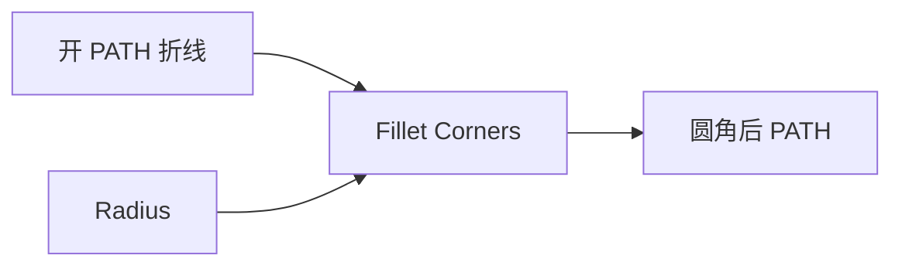

# Fillet Path Corners

| 字段 | 值 |
|---|---|
| 节点 ID | `geometry.curves.fillet_polyline_corners` |
| 分类 | `geometry.curves` |
| 显示名称 | Fillet Path Corners |
| 效果 | `PURE` |

## 作用

开路径内角用工作平面内圆弧倒圆。**不支持闭合路径**。

## 示意图



```text
  原:  ●──●
          │
          ●──●     尖角

  后:  ●──╮
          ╰──●     工作平面内圆弧
```

闭合折线请先拆开或用其它圆角策略；半径过大可能失败（Valid=false）。

## 端点

| 方向 | 显示名 | 端口 ID | 类型 |
|---|---|---|---|
| 入 | Path / Plane / Radius | … | PATH / PLANE / DOUBLE |
| 出 | Path | `output_path` | PATH |
| 出 | Valid / Error | `output_valid` / `output_error` | BOOLEAN / STRING |

## 使用步骤

1. 按端点表接好构造/编辑所需输入。
2. 检查 Valid；Geometry / Path / Profile 等接到下游。

## 典型接法

```text
[上游].… ──► [Fillet Path Corners].Path
[Fillet Path Corners].Path ──► [下游].…
```
