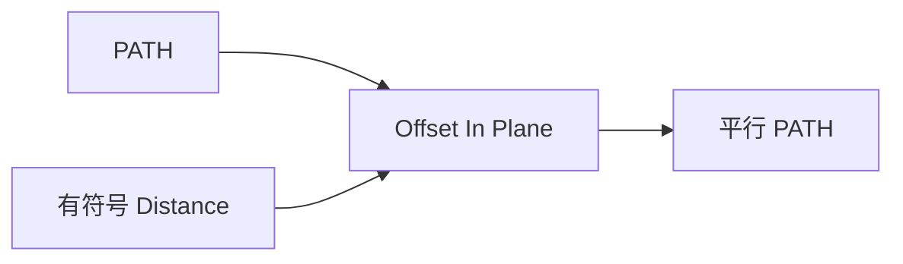

# Offset Path In Plane

| 字段 | 值 |
|---|---|
| 节点 ID | `geometry.curves.offset_curve_plane` |
| 分类 | `geometry.curves` |
| 显示名称 | Offset Path In Plane |
| 效果 | `PURE` |

## 作用

在包含曲线的工作平面内按有符号距离偏移路径。

## 示意图



```text
  原曲线  ─────────
  +Distance  ─────────   （平面内法向一侧）
  -Distance  ─────────   （另一侧）
```

自相交/尖角处偏移可能自交；复杂轮廓可改用 Profile Offset。

## 端点

| 方向 | 显示名 | 端口 ID | 类型 |
|---|---|---|---|
| 入 | Path / Plane / Offset | … | PATH / PLANE / DOUBLE |
| 出 | Path | `output_path` | PATH |
| 出 | Valid / Error | `output_valid` / `output_error` | BOOLEAN / STRING |

## 使用步骤

1. 按端点表接好构造/编辑所需输入。
2. 检查 Valid；Geometry / Path / Profile 等接到下游。

## 典型接法

```text
[上游].… ──► [Offset Path In Plane].Path
[Offset Path In Plane].Path ──► [下游].…
```
