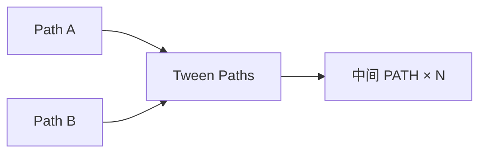

# Tween Paths

| 字段 | 值 |
|---|---|
| 节点 ID | `geometry.curves.tween_curves` |
| 分类 | `geometry.curves` |
| 显示名称 | Tween Paths |
| 效果 | `PURE` |

## 作用

两路径之间均匀插值出多条中间路径。面板可含输入端、反向等。

## 示意图



```text
  A ───────────
  ·  ·  ·  ·  ·   t=0.25 … 0.75
  B ───────────
  含端点时输出含 A/B；反向可对齐走向
```

单条过渡用 [Blend Paths](./blend_curves.md)；多条形态渐变用本节点。

## 端点

| 方向 | 显示名 | 端口 ID | 类型 |
|---|---|---|---|
| 入 | Path A / Path B / Count / Samples | … | PATH / PATH / INTEGER / INTEGER |
| 出 | Paths / Count | … | PATH_LIST / INTEGER |
| 出 | Valid / Error | `output_valid` / `output_error` | BOOLEAN / STRING |

## 使用步骤

1. 按端点表接好构造/编辑所需输入。
2. 检查 Valid；Geometry / Path / Profile 等接到下游。

## 典型接法

```text
[上游].… ──► [Tween Paths].Path A
[Tween Paths].Paths ──► [下游].…
```
