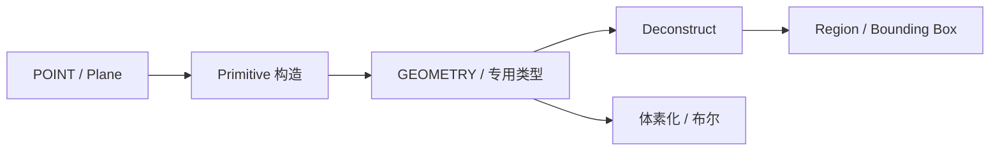

# geometry.primitives — 基础体素几何

构造连续空间中的盒体、球、柱、锥、胶囊、多面体等，并拆解回中心/轴/尺寸/包围盒。多数节点同时输出**专用几何类型**与统一的 `GEOMETRY`。

| 分组 | 教程 |
|---|---|
| 盒体 | [box](./box.md) · [box_from_corner_size](./box_from_corner_size.md) · [box_from_corners](./box_from_corners.md) · [deconstruct_box](./deconstruct_box.md) |
| 球 / 半球 | [sphere](./sphere.md) · [sphere_from_diameter](./sphere_from_diameter.md) · [hemisphere](./hemisphere.md) · [deconstruct_sphere](./deconstruct_sphere.md) · [deconstruct_hemisphere](./deconstruct_hemisphere.md) |
| 旋转体 | [cylinder](./cylinder.md) · [cone](./cone.md) · [frustum_cone](./frustum_cone.md) · [capsule](./capsule.md) · [torus](./torus.md) · [ellipsoid](./ellipsoid.md) + 对应 Deconstruct |
| 金字塔 / 棱柱 | [square_pyramid](./square_pyramid.md) · [deconstruct_prism](./deconstruct_prism.md) |
| 正多面体 | [tetrahedron](./tetrahedron.md) · [octahedron](./octahedron.md) · [icosahedron](./icosahedron.md) · [dodecahedron](./dodecahedron.md) + Deconstruct |

进度见 [PROGRESS.md](../../PROGRESS.md)。
