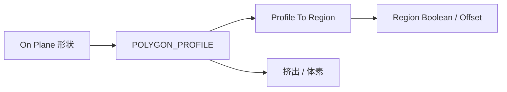

# geometry.profiles — 平面轮廓

在 PLANE 上构造 `POLYGON_PROFILE`，再做偏移、布尔、三角化，或提升为带孔的 `PLANAR_REGION`。下游常接挤出（solids）或体素化。

| 分组 | 教程 |
|---|---|
| 基础形状 | [rectangle](./rectangle_profile.md) · [circle](./circle_profile.md) · [ellipse](./ellipse_profile.md) · [polygon](./polygon_profile.md) · [rounded_rectangle](./rounded_rectangle_profile.md) · … |
| 自定义 | [custom_profile](./custom_profile.md) · [convex_hull](./convex_hull_plane.md) · [voronoi](./voronoi_cells_plane.md) |
| 编辑 | [resample](./resample_profile.md) · [offset](./offset_profile_plane.md) · [boolean_2d](./boolean_2d.md) · [triangulate](./triangulate_2d.md) |
| Region | [profile_to_region](./profile_to_region.md) · [region_boolean_2d](./region_boolean_2d.md) · [region_offset_plane](./region_offset_plane.md) · [annulus](./annulus_profile.md) |
| 拆解 | [deconstruct_profile](./deconstruct_profile.md) |

进度见 [PROGRESS.md](../../PROGRESS.md)。
