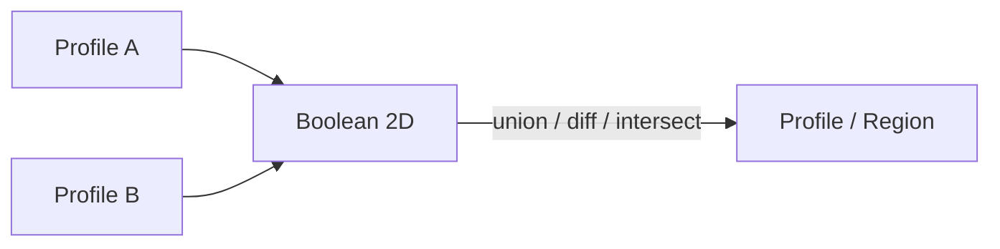

# Profile Boolean 2D

| 字段 | 值 |
|---|---|
| 节点 ID | `geometry.profiles.boolean_2d` |
| 分类 | `geometry.profiles` |
| 显示名称 | Profile Boolean 2D |
| 效果 | `PURE` |

## 作用

便捷节点：两共面轮廓提升为 Region 后做 2D 布尔（操作在面板属性，如 UNION）。

## 示意图



```text
  A ███      UNION     ██████
    ███   +  ░░░    →  ███░░░
         B ░░░         ███░░░

  须共面；面板选操作类型
```

3D 体素布尔见 [Difference](../boolean/difference.md)；SDF 布尔见 [SDF Boolean](../sdf/sdf_boolean.md)。

## 端点

| 方向 | 显示名 | 端口 ID | 类型 |
|---|---|---|---|
| 入 | Profile A / B | … | POLYGON_PROFILE |
| 出 | Region / Regions / Profile / Profiles / Plane / Center / Count | … | … |
| 出 | Valid / Error | `output_valid` / `output_error` | BOOLEAN / STRING |

## 使用步骤

1. 按端点表接好构造/编辑所需输入。
2. 检查 Valid；Geometry / Path / Profile 等接到下游。

## 典型接法

```text
[上游].… ──► [Profile Boolean 2D].Profile A
[Profile Boolean 2D].Region ──► [下游].…
```

## 注意事项

- 须共面。有孔结果以 Region 为准；带孔输入请用 [Region Boolean 2D](./region_boolean_2d.md)。
