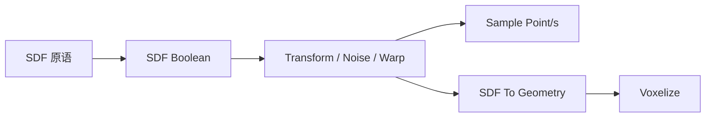

# geometry.sdf — 有符号距离场

用 `SDF` 表达隐式体：原语 → 布尔/变换/扰动 → 采样或包成 `GEOMETRY` 再体素化。节点 ID 前缀为 `geometry.boolean.sdf_*`，库分类为 `geometry.sdf`。

| 分组 | 教程 |
|---|---|
| 原语 | [sdf_sphere](./sdf_sphere.md) · [sdf_box](./sdf_box.md) · [sdf_capsule](./sdf_capsule.md) · [sdf_torus](./sdf_torus.md) |
| 组合 / 变形 | [sdf_boolean](./sdf_boolean.md) · [sdf_transform](./sdf_transform.md) · [sdf_noise_displace](./sdf_noise_displace.md) · [sdf_domain_warp](./sdf_domain_warp.md) |
| 采样 | [sdf_sample_point](./sdf_sample_point.md) · [sdf_sample_points](./sdf_sample_points.md) · [sdf_gradient_point](./sdf_gradient_point.md) · [sdf_blend_material_mask](./sdf_blend_material_mask.md) |
| 输出 | [sdf_to_geometry](./sdf_to_geometry.md) |

距离约定：负=体内，正=体外，0≈表面。表达式深度有预算上限。进度见 [PROGRESS.md](../../PROGRESS.md)。
