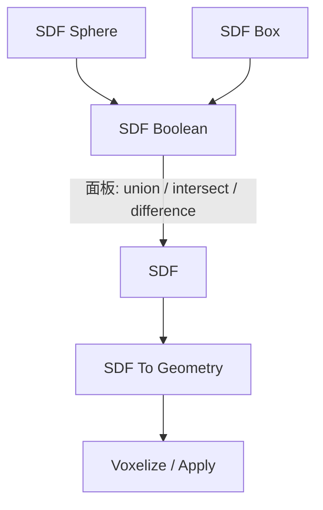

# SDF Boolean

| 字段 | 值 |
|---|---|
| 节点 ID | `geometry.boolean.sdf_boolean` |
| 分类 | `geometry.sdf` |
| 显示名称 | SDF Boolean |
| 效果 | `PURE` |

## 作用

两 SDF 做并/交/差；可选 Smooth K 平滑混合（0=硬布尔）。操作在面板属性。

## 示意图



```text
Smooth K = 0     硬边布尔
Smooth K > 0     圆角过渡（并/交/差均可软化）
```

与 [`geometry.boolean.Difference`](../boolean/difference.md) 不同：这里是**连续距离场**运算，体素化前一直是解析 SDF。

## 端点

| 方向 | 显示名 | 端口 ID | 类型 |
|---|---|---|---|
| 入 | A / B | `input_a` / `input_b` | SDF |
| 入 | Smooth K | `input_smooth_k` | DOUBLE |
| 出 | SDF | `output_sdf` | SDF |
| 出 | Valid / Error | `output_valid` / `output_error` | BOOLEAN / STRING |

## 使用步骤

1. 按端点表接好构造/编辑所需输入。
2. 检查 Valid；Geometry / Path / Profile 等接到下游。

## 典型接法

```text
[SDF Sphere] ──► A
[SDF Box] ──► B
[SDF Boolean] ──► [SDF To Geometry]
```
