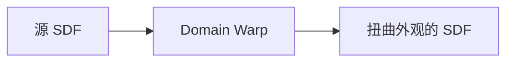

# SDF Domain Warp

| 字段 | 值 |
|---|---|
| 节点 ID | `geometry.boolean.sdf_domain_warp` |
| 分类 | `geometry.sdf` |
| 显示名称 | SDF Domain Warp |
| 效果 | `PURE` |

## 作用

采样前对坐标做噪声域扭曲（domain warp），再查源 SDF。

## 示意图



```text
  查询点 p ──噪声位移──► p' ── sample(SDF, p')
  光滑球 → 边缘呈噪声起伏（Amplitude / Frequency / Seed）
```

与 [Noise Displace](./sdf_noise_displace.md)（改距离值）不同：本节点改**采样坐标**。

## 端点

| 方向 | 显示名 | 端口 ID | 类型 |
|---|---|---|---|
| 入 | SDF | `input_sdf` | SDF |
| 入 | Warp Amplitude / Frequency / Seed | … | DOUBLE / DOUBLE / INTEGER（可选） |
| 出 | SDF | `output_sdf` | SDF |
| 出 | Valid / Error | `output_valid` / `output_error` | BOOLEAN / STRING |

## 使用步骤

1. 按端点表接好构造/编辑所需输入。
2. 检查 Valid；Geometry / Path / Profile 等接到下游。

## 典型接法

```text
[上游].… ──► [SDF Domain Warp].SDF
[SDF Domain Warp].SDF ──► [下游].…
```

## 注意事项

- 与 Noise Displace 不同：扭曲查询点而非直接加减距离。
