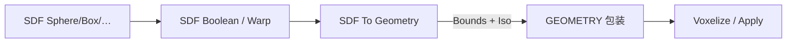

# SDF To Geometry

| 字段 | 值 |
|---|---|
| 节点 ID | `geometry.boolean.sdf_to_geometry` |
| 分类 | `geometry.sdf` |
| 显示名称 | SDF To Geometry |
| 效果 | `PURE` |

## 作用

把 SDF 包成可体素化的 `GEOMETRY`；可显式 Bounds Min/Max，或开 Auto Bounds + Padding。

## 示意图



```text
  SDF 场（连续） ──包装──► GeometryData
       ▲                      │
   Iso Value               烘焙时按 Bounds
   采样包围盒              在方块格求值
```

本节点**不**立刻体素化；只绑定采样范围，真正出块在 Voxelize / Apply。

## 端点

| 方向 | 显示名 | 端口 ID | 类型 |
|---|---|---|---|
| 入 | SDF | `input_sdf` | SDF |
| 入 | Bounds Min / Max | … | POINT（Auto Bounds 时可省略） |
| 入 | Iso Value | `input_iso` | DOUBLE（0=标准等值面） |
| 入 | Padding | `input_padding` | DOUBLE（可选） |
| 出 | Geometry | `output_geometry` | GEOMETRY |
| 出 | Valid / Error | `output_valid` / `output_error` | BOOLEAN / STRING |

## 使用步骤

1. 按端点表接好构造/编辑所需输入。
2. 检查 Valid；Geometry / Path / Profile 等接到下游。

## 典型接法

```text
[上游].… ──► [SDF To Geometry].SDF
[SDF To Geometry].Geometry ──► [下游].…
```

## 注意事项

- 下游接 Voxelize Geometry；Iso≠0 会偏移等值面。
