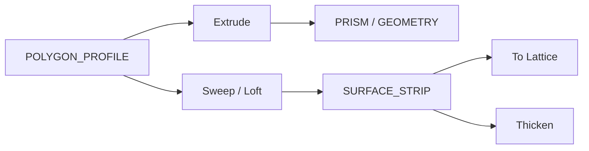

# geometry.solids — 挤出 / 放样 / 扫掠 / 曲面条带

从轮廓或点列生成**实体棱柱**，或 **SURFACE_STRIP**（曲面拓扑，非实心）。Loft / Sweep / Revolve 主输出多为条带；实心用 Extrude / Extrude Region / Prism。条带可转格子预览或加厚。

| 分组 | 教程 |
|---|---|
| 挤出实体 | [extrude](./extrude.md) · [extrude_region](./extrude_region.md) · [extrude_profile_from_points](./extrude_profile_from_points.md) · [extrude_from_points](./extrude_from_points.md) |
| 盒体面 | [extrude_box_face](./extrude_box_face.md) · [push_pull_face](./push_pull_face.md) |
| 放样 / 扫掠 | [loft](./loft.md) · [loft_from_points](./loft_from_points.md) · [loft_multi_section](./loft_multi_section.md) · [sweep](./sweep.md) · [sweep_from_points](./sweep_from_points.md) · [sweep_two_rails](./sweep_two_rails.md) · [revolve](./revolve.md) |
| 条带处理 | [offset_surface_strip](./offset_surface_strip.md) · [thicken_surface](./thicken_surface.md) · [extract…](./extract_surface_strip_range.md) · [deconstruct…](./deconstruct_surface_strip.md) · [lattice](./surface_strip_to_lattice.md) |
| 剖切 / 投影 | [section_cut](./section_cut.md) · [contour](./contour.md) · [shrinkwrap…](./shrinkwrap_points_surface_strip.md) |

进度见 [PROGRESS.md](../../PROGRESS.md)。
