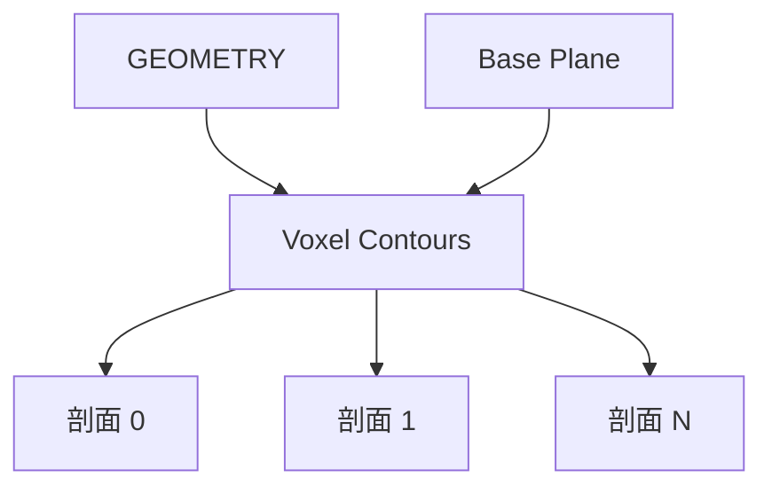

# Voxel Contours

| 字段 | 值 |
|---|---|
| 节点 ID | `geometry.solids.contour` |
| 分类 | `geometry.solids` |
| 显示名称 | Voxel Contours |
| 效果 | `PURE` |

## 作用

沿基平面法向等距生成多个剖切面并追踪轮廓。

## 示意图



```text
  Base Plane ─ ─ ─ ─ ─
       ↑ Spacing
  ─ ─ ─ ─ ─ ─ ─ ─ ─   Contour 1
       ↑
  ─ ─ ─ ─ ─ ─ ─ ─ ─   Contour 2 …
  Start Distance = 第一刀相对基面偏移
```

单刀剖切用 [Voxel Section](./section_cut.md)；本节点批量等高/等距切片。

## 端点

| 方向 | 显示名 | 端口 ID | 类型 |
|---|---|---|---|
| 入 | Geometry / Base Plane | … | GEOMETRY / PLANE（默认 XY） |
| 入 | Start Distance / Spacing / Count / Thickness | … | DOUBLE / DOUBLE / INTEGER / DOUBLE |
| 出 | Profile · Boundaries · Regions（主+列表）/ Planes / Contour Count | … | … |
| 出 | Valid / Error | `output_valid` / `output_error` | BOOLEAN / STRING |

## 使用步骤

1. 按端点表接好构造/编辑所需输入。
2. 检查 Valid；Geometry / Path / Profile 等接到下游。

## 典型接法

```text
[上游].… ──► [Voxel Contours].Geometry
[Voxel Contours].Profile ──► [下游].…
```

## 注意事项

- Count 有上限（GenerationLimits.MAX_SECTION_PLANES）。
