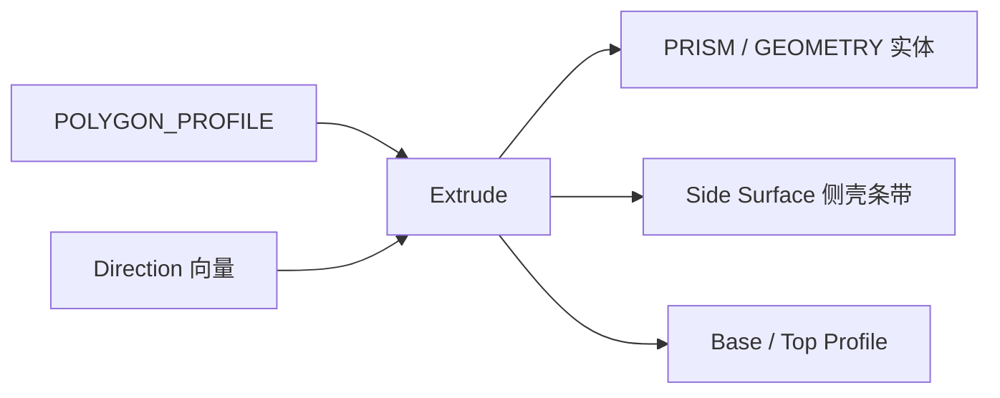

# Extrude

| 字段 | 值 |
|---|---|
| 节点 ID | `geometry.solids.extrude` |
| 分类 | `geometry.solids` |
| 显示名称 | Extrude |
| 效果 | `PURE` |

## 作用

轮廓沿方向向量挤出为**棱柱实体**（规范 Extrude）。

## 示意图



```text
  顶轮廓 ○───○
         ║▓▓▓║  ← Direction 长度 = 高度
  底轮廓 ○───○
         侧壳 = SURFACE_STRIP（非实心）
```

实体走 Geometry/Prism；只要壳用 Side Surface → Thicken。

## 端点

| 方向 | 显示名 | 端口 ID | 类型 |
|---|---|---|---|
| 入 | Profile / Direction | … | POLYGON_PROFILE / VECTOR |
| 出 | Prism / Geometry | … | PRISM_GEOMETRY / GEOMETRY |
| 出 | Base / Top Profile · Points | … | POLYGON_PROFILE / POINT_LIST |
| 出 | Side Surface | `output_side_surface` | SURFACE_STRIP（侧壳，非实体） |
| 出 | Height | `output_height` | DOUBLE |
| 出 | Valid / Error | `output_valid` / `output_error` | BOOLEAN / STRING |

## 使用步骤

1. 按端点表接好构造/编辑所需输入。
2. 检查 Valid；Geometry / Path / Profile 等接到下游。

## 典型接法

```text
[Circle On Plane].Profile ──► [Extrude].Profile
[Vector].Up ──► [Extrude].Direction
[Extrude].Geometry ──► Voxelize
```
