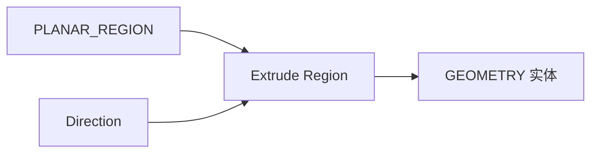

# Extrude Region

| 字段 | 值 |
|---|---|
| 节点 ID | `geometry.solids.extrude_region` |
| 分类 | `geometry.solids` |
| 显示名称 | Extrude Region |
| 效果 | `PURE` |

## 作用

平面 Region（外环+孔）挤出为实体：有孔时为棱柱差。

## 示意图



```text
  外环 ████████     挤出后
      ██    ██         实心墙 + 空洞（孔被减）
      ██░░░░██
  孔 = 内环
```

无孔简单轮廓可用 [Extrude](./extrude.md)；有洞/多环用本节点。

## 端点

| 方向 | 显示名 | 端口 ID | 类型 |
|---|---|---|---|
| 入 | Region / Direction | … | PLANAR_REGION / VECTOR |
| 出 | Geometry | … | GEOMETRY |
| 出 | Base / Top Region | … | PLANAR_REGION |
| 出 | Outer Side Surface / Hole Side Surfaces | … | SURFACE_STRIP / SURFACE_STRIP_LIST |
| 出 | Height | … | DOUBLE |
| 出 | Valid / Error | `output_valid` / `output_error` | BOOLEAN / STRING |

## 使用步骤

1. 按端点表接好构造/编辑所需输入。
2. 检查 Valid；Geometry / Path / Profile 等接到下游。

## 典型接法

```text
[Annulus].Region ──► [Extrude Region].Region
[Extrude Region].Geometry ──► Voxelize
```
