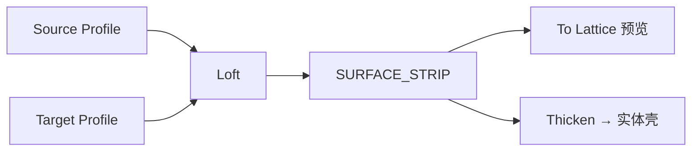

# Loft Surface

| 字段 | 值 |
|---|---|
| 节点 ID | `geometry.solids.loft` |
| 分类 | `geometry.solids` |
| 显示名称 | Loft Surface |
| 效果 | `PURE` |

## 作用

两轮廓放样为 **SURFACE_STRIP**（曲面，非实体）。顶点数不同时按 Match Sections 重采样。

## 示意图



```text
  ○───○───○     Source
   \  |  /
    \ | /
     \|/
  ○───○───○     Target   →  侧壳条带（非实心棱柱）
```

要实心请用 [Extrude](./extrude.md) / [Extrude Region](./extrude_region.md)；条带加厚用 [Thicken Surface](./thicken_surface.md)。

## 端点

| 方向 | 显示名 | 端口 ID | 类型 |
|---|---|---|---|
| 入 | Source / Target Profile | … | POLYGON_PROFILE |
| 出 | Side Surface | `output_side_surface` | SURFACE_STRIP（主输出） |
| 出 | Source/Target Profile·Points · Rails · Trees · Count | … | … |
| 出 | Valid / Error | `output_valid` / `output_error` | BOOLEAN / STRING |

## 使用步骤

1. 按端点表接好构造/编辑所需输入。
2. 检查 Valid；Geometry / Path / Profile 等接到下游。

## 典型接法

```text
[上游].… ──► [Loft Surface].Source
[Loft Surface].Side Surface ──► [下游].…
```

## 注意事项

- 要线框预览接 [Surface Strip To Lattice](./surface_strip_to_lattice.md)。
