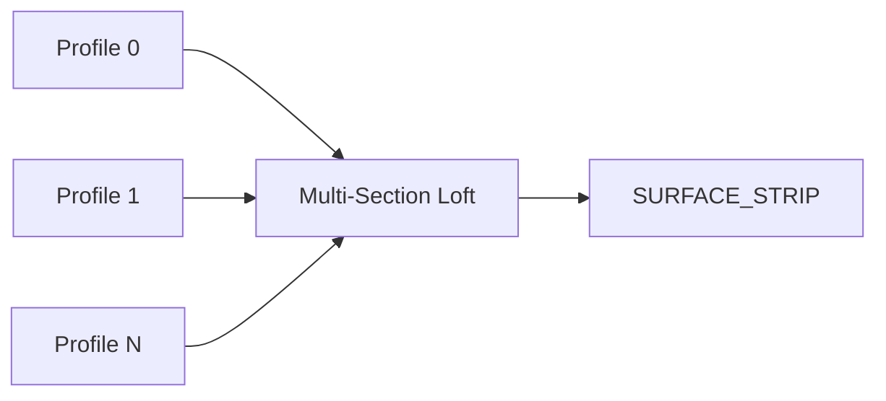

# Multi-Section Loft Surface

| 字段 | 值 |
|---|---|
| 节点 ID | `geometry.solids.loft_multi_section` |
| 分类 | `geometry.solids` |
| 显示名称 | Multi-Section Loft Surface |
| 效果 | `PURE` |

## 作用

多截面轮廓列表放样为一条 SURFACE_STRIP；面板有闭合/翻转/接缝/重采样。

## 示意图



```text
  ○───○     截面 0
   \ /
    ×       截面 1
   / \
  ●───●     截面 2  →  连续侧壳
```

两截面用 [Loft](./loft.md)；截面间形态过渡可先 [Morph](./morph_profiles.md) 再列表放样。

## 端点

| 方向 | 显示名 | 端口 ID | 类型 |
|---|---|---|---|
| 入 | Profiles | `input_profiles` | POLYGON_PROFILE_LIST |
| 出 | Side Surface | … | SURFACE_STRIP |
| 出 | Profiles / Paths / Rails / Trees / Section Count | … | … |
| 出 | Valid / Error | `output_valid` / `output_error` | BOOLEAN / STRING |

## 使用步骤

1. 按端点表接好构造/编辑所需输入。
2. 检查 Valid；Geometry / Path / Profile 等接到下游。

## 典型接法

```text
[上游].… ──► [Multi-Section Loft Surface].Profiles
[Multi-Section Loft Surface].Side Surface ──► [下游].…
```
