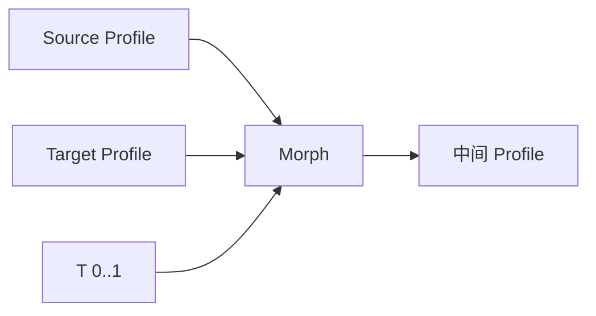

# Morph Between Profiles

| 字段 | 值 |
|---|---|
| 节点 ID | `geometry.solids.morph_profiles` |
| 分类 | `geometry.solids` |
| 显示名称 | Morph Between Profiles |
| 效果 | `PURE` |

## 作用

两兼容轮廓按 T∈[0,1] 插值；面板 Match Seam / Flip。

## 示意图



```text
  T=0  ○───○───○     Source
  T=½  ◐───◐───◐     插值
  T=1  ●───●───●     Target
```

接缝不对齐时开 Match Seam；绕向相反时 Flip。常与 Loft 截面动画配合。

## 端点

| 方向 | 显示名 | 端口 ID | 类型 |
|---|---|---|---|
| 入 | Source / Target Profile / T | … | POLYGON_PROFILE ×2 / DOUBLE |
| 出 | Profile / Boundary / Points | … | POLYGON_PROFILE / PATH / POINT_LIST |
| 出 | Valid / Error | `output_valid` / `output_error` | BOOLEAN / STRING |

## 使用步骤

1. 按端点表接好构造/编辑所需输入。
2. 检查 Valid；Geometry / Path / Profile 等接到下游。

## 典型接法

```text
[上游].… ──► [Morph Between Profiles].Source
[Morph Between Profiles].Profile ──► [下游].…
```

## 注意事项

- T 必须在 [0,1]。
