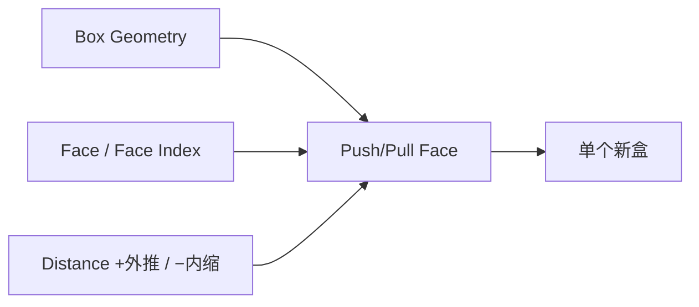

# Push/Pull Box Face

| 字段 | 值 |
|---|---|
| 节点 ID | `geometry.solids.push_pull_face` |
| 分类 | `geometry.solids` |
| 显示名称 | Push/Pull Box Face |
| 效果 | `PURE` |

## 作用

移动盒体一面（推拉）得到**单个**新盒（非复合段）。

## 示意图



```text
  原盒 ██████      Distance>0
       ██│███  →  ███████  该面沿法线推出
         ▲Face            （仍是一整个 AABB/定向盒）
```

不是布尔加块；结果是变形后的**单一**盒几何。

## 端点

| 方向 | 显示名 | 端口 ID | 类型 |
|---|---|---|---|
| 入 | Box Geometry / Face / Face Index / Distance | … | … |
| 出 | Geometry / Box Geometry / Found / Resolved Face Index | … | … |
| 出 | Valid / Error | `output_valid` / `output_error` | BOOLEAN / STRING |

## 使用步骤

1. 按端点表接好构造/编辑所需输入。
2. 检查 Valid；Geometry / Path / Profile 等接到下游。

## 典型接法

```text
[上游].… ──► [Push/Pull Box Face].Box Geometry
[Push/Pull Box Face].Geometry ──► [下游].…
```

## 注意事项

- 距离过大导致半尺寸 ≤ 0 会失败。与 Extrude Box Face 不同：改原盒尺寸而非加一段。
