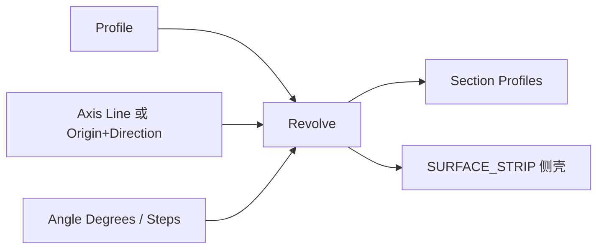

# Revolve Surface

| 字段 | 值 |
|---|---|
| 节点 ID | `geometry.solids.revolve` |
| 分类 | `geometry.solids` |
| 显示名称 | Revolve Surface |
| 效果 | `PURE` |

## 作用

轮廓绕轴旋转，输出截面轮廓列表与侧 Surface Strip。

## 示意图



```text
        轴 ↑
        │  ╱── Profile
        │ ╱
        ●──────── 旋转 Angle（度）
         ╲
          ╲── 截面环 / 侧条带
```

Steps 控制周向分段；不是实心回转体——要实体需再 Thicken / 其它实体节点。

## 端点

| 方向 | 显示名 | 端口 ID | 类型 |
|---|---|---|---|
| 入 | Profile | … | POLYGON_PROFILE |
| 入 | Axis Line | … | LINE（可选） |
| 入 | Axis Origin / Direction | … | POINT / VECTOR（无 Line 时） |
| 入 | Angle Degrees / Steps | … | DOUBLE / INTEGER |
| 出 | Section Profiles / Paths / All Points / Surface Strip / Section Count | … | … |
| 出 | Valid / Error | `output_valid` / `output_error` | BOOLEAN / STRING |

## 使用步骤

1. 按端点表接好构造/编辑所需输入。
2. 检查 Valid；Geometry / Path / Profile 等接到下游。

## 典型接法

```text
[上游].… ──► [Revolve Surface].Profile
[Revolve Surface].Section Profiles ──► [下游].…
```
