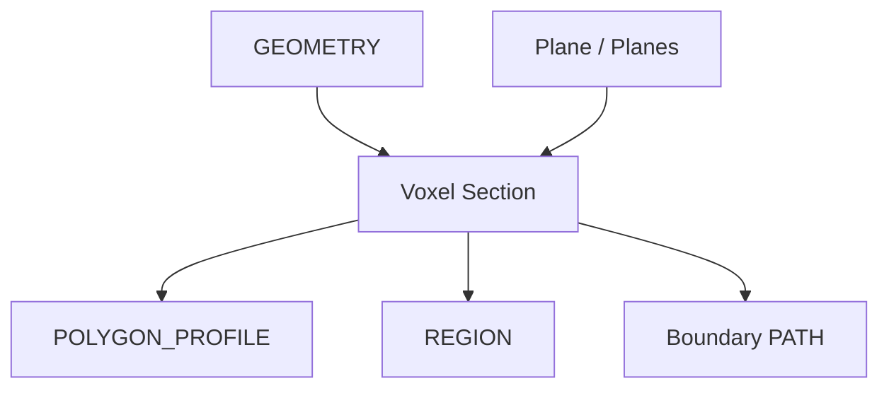

# Voxel Section

| 字段 | 值 |
|---|---|
| 节点 ID | `geometry.solids.section_cut` |
| 分类 | `geometry.solids` |
| 显示名称 | Voxel Section |
| 效果 | `PURE` |

## 作用

用一或多个平面剖切几何，追踪体素切片轮廓为 Profile / Region 等。

## 示意图



```text
         ════ Plane ════
              │
     █████████│█████████  几何
     █████████│█████████
              │
         → 切片轮廓 Profile
```

多平面时按平面分支进 Data Tree；Thickness 控制切片厚度容差。

## 端点

| 方向 | 显示名 | 端口 ID | 类型 |
|---|---|---|---|
| 入 | Geometry | … | GEOMETRY |
| 入 | Plane / Planes | … | PLANE / PLANE_LIST（多平面时按平面分支） |
| 入 | Thickness | … | DOUBLE |
| 出 | Profile / Boundary / Region（主）及列表 / Trees | … | … |
| 出 | Valid / Error | `output_valid` / `output_error` | BOOLEAN / STRING |

## 使用步骤

1. 按端点表接好构造/编辑所需输入。
2. 检查 Valid；Geometry / Path / Profile 等接到下游。

## 典型接法

```text
[上游].… ──► [Voxel Section].Geometry
[Voxel Section].Profile ──► [下游].…
```
