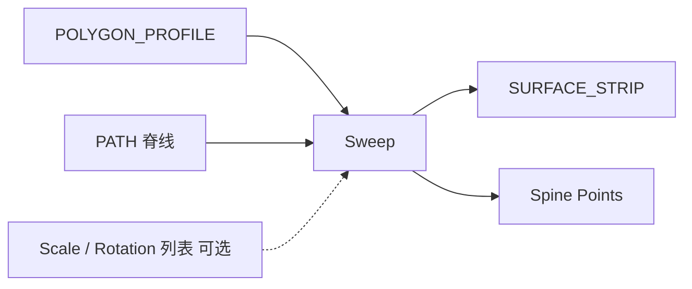

# Sweep Surface

| 字段 | 值 |
|---|---|
| 节点 ID | `geometry.solids.sweep` |
| 分类 | `geometry.solids` |
| 显示名称 | Sweep Surface |
| 效果 | `PURE` |

## 作用

轮廓沿 PATH 扫掠为 SURFACE_STRIP。可选沿路径 Scale / Rotation 列表。

## 示意图



```text
  轮廓 ○          沿路径 →→→
       ║▓▓▓▓▓▓▓▓▓  扫成管状/槽状侧壳
  脊线 ─────────
```

## 端点

| 方向 | 显示名 | 端口 ID | 类型 |
|---|---|---|---|
| 入 | Profile / Path | … | POLYGON_PROFILE / PATH |
| 入 | Scale / Rotation Values | … | DOUBLE_LIST（可选） |
| 出 | Surface Strip | … | SURFACE_STRIP（主输出） |
| 出 | Spine Points · Section Profiles/Paths · Trees · Count | … | … |
| 出 | Valid / Error | `output_valid` / `output_error` | BOOLEAN / STRING |

## 使用步骤

1. 按端点表接好构造/编辑所需输入。
2. 检查 Valid；Geometry / Path / Profile 等接到下游。

## 典型接法

```text
[上游].… ──► [Sweep Surface].Profile
[Sweep Surface].Surface Strip ──► [下游].…
```
