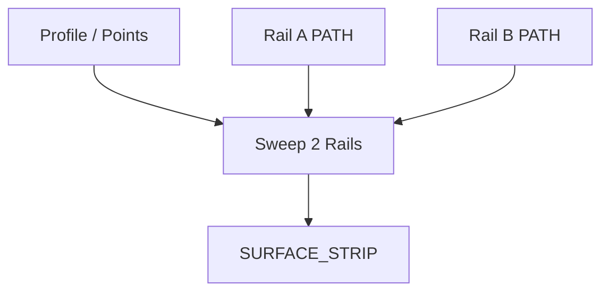

# Sweep 2 Rails

| 字段 | 值 |
|---|---|
| 节点 ID | `geometry.solids.sweep_two_rails` |
| 分类 | `geometry.solids` |
| 显示名称 | Sweep 2 Rails |
| 效果 | `PURE` |

## 作用

轮廓（或点列）在两导轨之间扫掠；面板控制截面数、起终缩放/旋转。

## 示意图



```text
  Rail A  ─────────────────
         ╱ 截面 Profile ╲
  Rail B  ─────────────────
         →→ 沿双轨推进，宽度随轨距变化
```

单轨扫掠见 [Sweep](./sweep.md)；双轨适合道路、坡面、变宽槽。

## 端点

| 方向 | 显示名 | 端口 ID | 类型 |
|---|---|---|---|
| 入 | Profile / Profile Points | … | POLYGON_PROFILE / POINT_LIST（二选一） |
| 入 | Rail A / B Path | … | PATH |
| 入 | Scale / Rotation Values | … | DOUBLE_LIST（可选） |
| 出 | Surface Strip · Rail Points · Sections · Count | … | … |
| 出 | Valid / Error | `output_valid` / `output_error` | BOOLEAN / STRING |

## 使用步骤

1. 按端点表接好构造/编辑所需输入。
2. 检查 Valid；Geometry / Path / Profile 等接到下游。

## 典型接法

```text
[上游].… ──► [Sweep 2 Rails].Profile
[Sweep 2 Rails].Surface Strip ──► [下游].…
```
