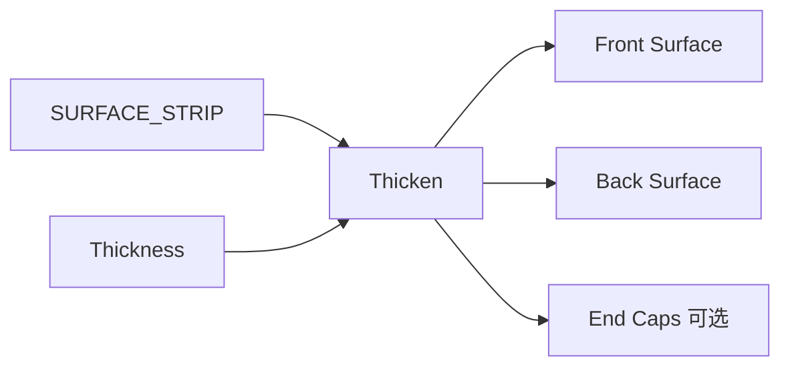

# Thicken Surface

| 字段 | 值 |
|---|---|
| 节点 ID | `geometry.solids.thicken_surface` |
| 分类 | `geometry.solids` |
| 显示名称 | Thicken Surface |
| 效果 | `PURE` |

## 作用

条带加厚为前/后两层，可选端盖条带。

## 示意图



```text
  单层条带 ═══
       ↓ ±Thickness/2 沿法向
  前壳 ═════╗
            ║  空心壳
  后壳 ═════╝
       + 端盖封口（可选）
```

Loft / Sweep / Revolve 的条带常用本节点变「有厚度的壳」。

## 端点

| 方向 | 显示名 | 端口 ID | 类型 |
|---|---|---|---|
| 入 | Surface Strip / Thickness | … | SURFACE_STRIP / DOUBLE |
| 出 | Front / Back Surface | … | SURFACE_STRIP |
| 出 | End Caps / All Surfaces | … | SURFACE_STRIP_LIST |
| 出 | Region / Layer Count / Thickness | … | … |
| 出 | Valid / Error | `output_valid` / `output_error` | BOOLEAN / STRING |

## 使用步骤

1. 按端点表接好构造/编辑所需输入。
2. 检查 Valid；Geometry / Path / Profile 等接到下游。

## 典型接法

```text
[上游].… ──► [Thicken Surface].Surface Strip
[Thicken Surface].Front ──► [下游].…
```
