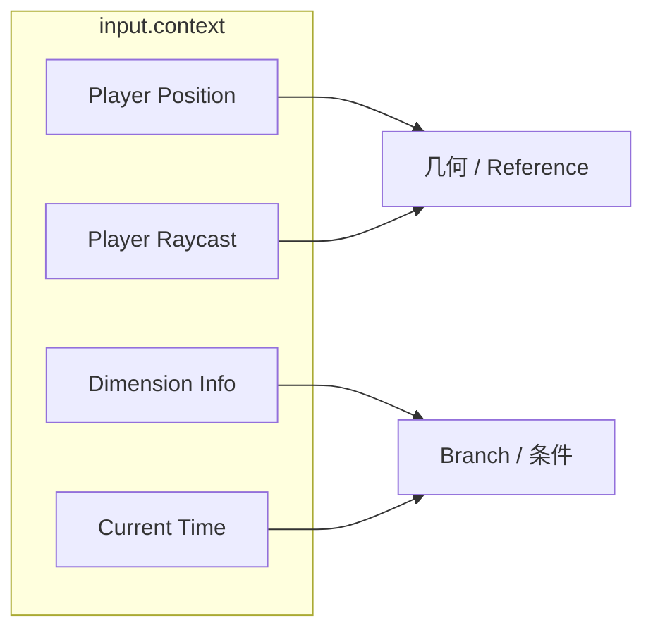

# input.context — 世界 / 玩家上下文

从**当前 Minecraft 世界与玩家**读取只读上下文（位置、视线、维度、时间天气）。多数节点需要有效世界上下文；无上下文时 **Valid = false**。

| 节点 | 教程 | 一句话 |
|---|---|---|
| Player Position Snapshot | [player_position.md](./player_position.md) | 冻结玩家坐标快照 |
| Player View Raycast | [player_raycast.md](./player_raycast.md) | 视线射线命中点 / 方块 / 实体 |
| Dimension Info | [dimension_info.md](./dimension_info.md) | 当前维度与天空/天花板特征 |
| Current Time | [current_time.md](./current_time.md) | 世界时间与天气状态 |

进度见 [PROGRESS.md](../../PROGRESS.md)。
