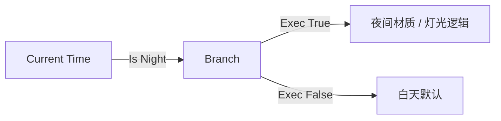

# Current Time

| 字段 | 值 |
|---|---|
| 节点 ID | `input.context.current_time` |
| 分类 | `input.context` |
| 显示名称 | Current Time |
| 效果 | `WORLD_READ`（只读上下文） |

## 作用

读取当前世界的时间与天气：总 tick、天数、一天内时间、时/分，以及白天 / 夜晚 / 下雨 / 雷暴标志。适合昼夜切换、天气驱动的材质或生成规则。

## 端点

### 输出

| 显示名 | 端口 ID | 类型 | 说明 |
|---|---|---|---|
| Valid | `output_valid` | BOOLEAN | 世界上下文是否可用 |
| Time (Ticks) | `output_time_ticks` | DOUBLE | 世界总时间（tick） |
| Day | `output_day` | INTEGER | 当前天数 |
| Day Time | `output_day_time` | INTEGER | 一天内时间 0–24000 |
| Hour | `output_hour` | INTEGER | 小时 0–23 |
| Minute | `output_minute` | INTEGER | 分钟 0–59 |
| Is Day | `output_is_day` | BOOLEAN | 是否白天 |
| Is Night | `output_is_night` | BOOLEAN | 是否夜晚 |
| Is Raining | `output_is_raining` | BOOLEAN | 是否下雨 |
| Is Thundering | `output_is_thundering` | BOOLEAN | 是否雷暴 |

## 使用步骤

1. 拖入节点（需有活动世界）。
2. 简单昼夜分支用 **Is Day** / **Is Night**。
3. 需要细粒度动画或表达式时用 **Day Time** / **Hour**。

## 典型接法

## 注意事项

- **Time (Ticks)** 类型是 DOUBLE，接到整数口前注意转换。
- 无世界上下文 → Valid false，其余输出不可用。
- 天气与时间随世界实时变化；需要「冻结某一刻」时应另存变量或只读一次。
