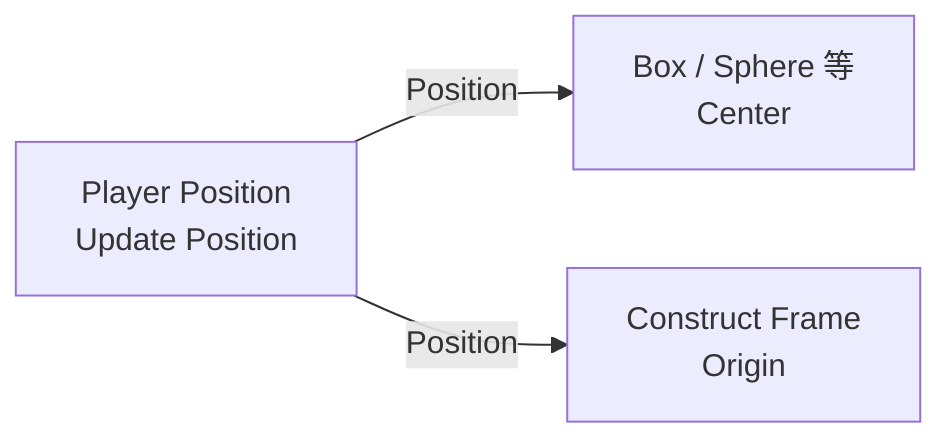

# Player Position Snapshot

| 字段 | 值 |
|---|---|
| 节点 ID | `input.context.player_position` |
| 分类 | `input.context` |
| 显示名称 | Player Position Snapshot |
| 效果 | `WORLD_READ` |

## 作用

捕获玩家在世界中的**连续坐标快照**（POINT + XYZ），之后保持稳定，不会跟着玩家走动一直变。需要更新时点节点上的 **Update Position**。

适合把「站在这里造」定成固定原点，再接几何 / Reference。

## 端点

### 输入

无（UI 按钮 + 属性驱动）。

### 输出

| 显示名 | 端口 ID | 类型 | 说明 |
|---|---|---|---|
| Valid | `output_valid` | BOOLEAN | 是否已有可用快照 |
| Position | `output_position` | POINT | 连续世界坐标 |
| X / Y / Z | `output_x` / `output_y` / `output_z` | DOUBLE | 分量 |

### 属性

| 属性 | 说明 |
|---|---|
| Use Eye Position | `true` 用眼睛高度；`false`（默认）用脚底位置。改属性**不会**自动重捕，需再点 Update Position |

## 使用步骤

1. 站到目标位置，拖入本节点。
2. （可选）勾选 **Use Eye Position**。
3. 点击 **Update Position** 捕获快照。
4. 把 **Position**（或 X/Y/Z）接到 Construct Point / Frame / 几何原点。

## 典型接法



```text
[Player Position].Position ──► [某几何].Center / Origin
```

## 注意事项

- 快照是**会话内**的，**不会**随图存档持久化；重开图后需重新 Update。
- 首次执行时若还没有缓存，会尝试从执行上下文捕获；UI 按钮始终以客户端玩家为准。
- 无玩家 / 无上下文时 **Valid = false**。
