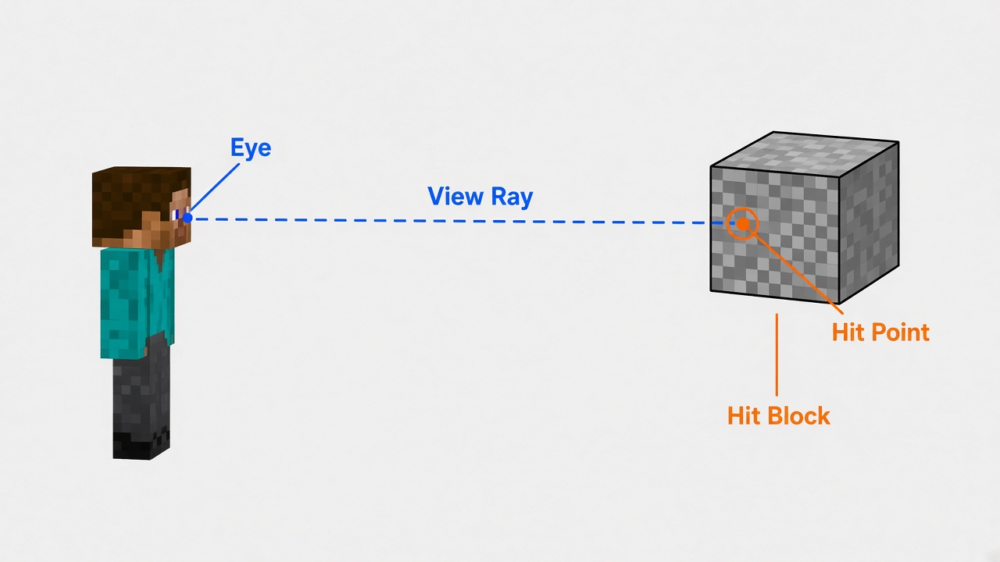
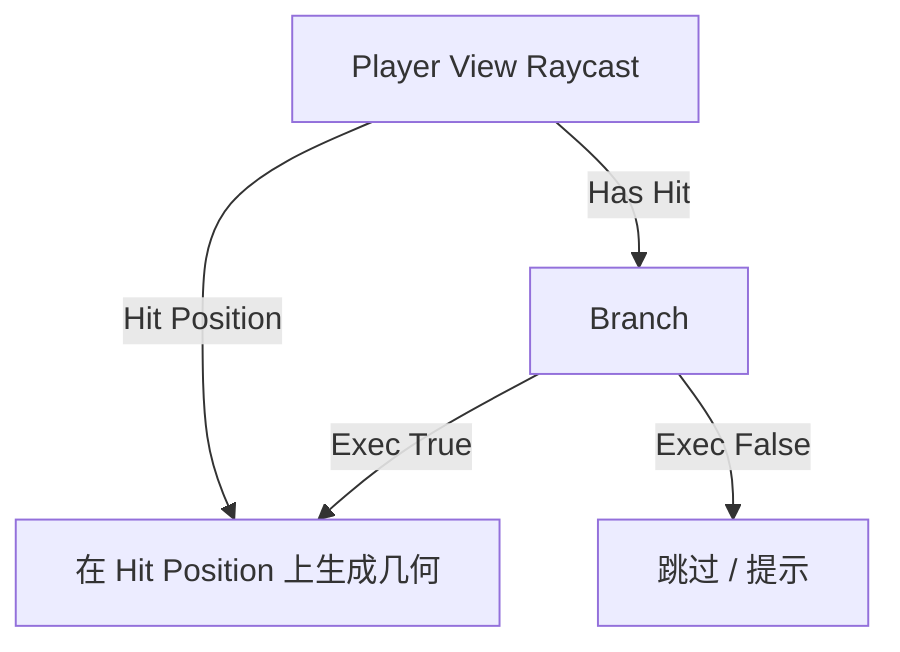

# Player View Raycast

| 字段 | 值 |
|---|---|
| 节点 ID | `input.context.player_raycast` |
| 分类 | `input.context` |
| 显示名称 | Player View Raycast |
| 效果 | `WORLD_READ` |

## 作用

从玩家**眼睛 / 视线方向**发出射线（仅已加载区块），报告命中位置、方块、实体与距离。适合「准星指哪儿就在哪儿建造 / 查询」。



## 端点

### 输入

无（属性调节射线行为）。

### 输出

| 显示名 | 端口 ID | 类型 | 说明 |
|---|---|---|---|
| Valid | `output_valid` | BOOLEAN | 是否有可用世界 / 玩家上下文 |
| Error | `output_error` | STRING | Valid 为 false 时的原因 |
| Hit Position | `output_hit_position` | POINT | 世界空间命中点 |
| Hit Block | `output_hit_block` | BLOCK_INFO | 命中方块快照；实体命中或未命中时为 null |
| Hit Entity | `output_hit_entity` | ENTITY_INFO | 命中实体快照（非活 Entity 引用）；方块命中或未命中时为 null |
| Hit Distance | `output_hit_distance` | DOUBLE | 到命中点的距离 |
| Has Hit | `output_has_hit` | BOOLEAN | 是否命中任何东西 |

### 属性

| 属性 | 默认 | 说明 |
|---|---|---|
| Max Distance | `100` | 最大射线距离 |
| Include Entities | `true` | 是否检测实体 |
| Include Fluids | `false` | 是否把流体当命中目标 |

## 使用步骤

1. 进入世界，拖入本节点。
2. 按需调整 Max Distance / Include Entities / Include Fluids。
3. 用 **Has Hit** 做分支；用 **Hit Position** 当建造原点或查询点。
4. 需要方块信息时接 **Hit Block**；需要实体信息时接 **Hit Entity**。

## 典型接法



```text
[Player Raycast].Has Hit      ──► [Branch].Condition
[Player Raycast].Hit Position ──► [几何 / World Query].Point
[Branch].Exec True            ──► 后续建造 EXEC
```

## 注意事项

- 只检测**已加载区块**；瞄向未加载区域可能未命中。
- **Hit Entity** 是快照数据，不是可长期持有的活实体引用。
- 方块命中与实体命中互斥：一边有值时另一边通常为 null。
- 无世界 / 玩家上下文 → Valid false，看 Error。
