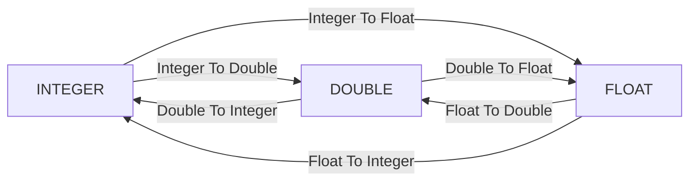

# input.numeric — 数值输入

手动输入、滑条、角度、二维垫、数值域，以及显式类型转换与常量。

| 分组 | 节点 | 教程 |
|---|---|---|
| 标量输入 | Integer / Number Input | [integer.md](./integer.md) · [float.md](./float.md) |
| 滑条 | Integer / Number Slider | [integer_slider.md](./integer_slider.md) · [float_slider.md](./float_slider.md) |
| 角度 | Angle Slider / Circular Picker | [angle.md](./angle.md) · [angle_picker.md](./angle_picker.md) |
| 二维 / 域 | XY Slider / Domain Input | [xy_slider.md](./xy_slider.md) · [range.md](./range.md) |
| 常量 | Pi / E | [pi.md](./pi.md) · [e.md](./e.md) |
| 转换 | INT ↔ DOUBLE ↔ FLOAT | 见下方矩阵 |

**选型提示**

- 要精确敲数、范围可很大 → Input（Number 的 Min/Max 可选）
- 要在有界区间里拧参数 → Slider（Number Slider 的 Min/Max **必须**有效）
- 图语言里角度默认是**度**；要弧度请接 `math.trigonometry` 的 Degrees To Radians

进度见 [PROGRESS.md](../../PROGRESS.md)。
