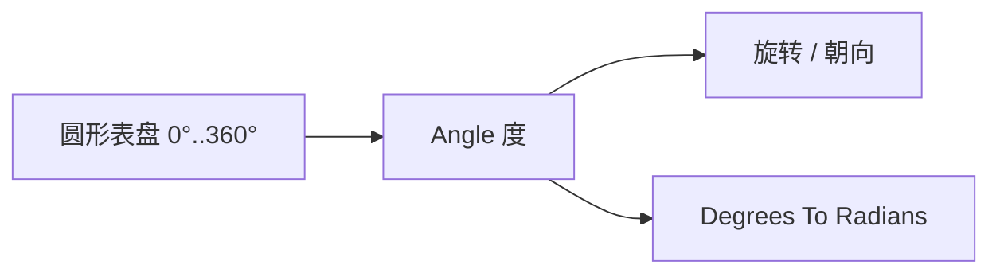

# Circular Angle Picker

| 字段 | 值 |
|---|---|
| 节点 ID | `input.numeric.angle_picker` |
| 分类 | `input.numeric` |
| 显示名称 | Circular Angle Picker |
| 效果 | `PURE` |

## 作用

圆形表盘点选角度（度），输出 DOUBLE。比滑条更直观地「拧方向」。需要弧度时接 Degrees To Radians。



## 端点

### 输出

| 显示名 | 端口 ID | 类型 | 说明 |
|---|---|---|---|
| Angle | `output_angle` | DOUBLE | 当前角度（度，通常 0–360） |

### 属性（常用）

| 属性 | 说明 |
|---|---|
| 角度 | 当前值（度） |
| 显示数值输入 | 是否显示数字输入 |
| Allow Direct Drawing 等 | UI 绘制相关选项 |

## 使用步骤

1. 在表盘上拖动手柄，或输入角度数。
2. 把 **Angle** 接到旋转 / 弧 / 朝向。

## 典型接法

```text
[Circular Angle Picker].Angle ──► [Rotate Around Axis].Angle
```

## 注意事项

- 与 Angle Slider 一样输出**度**。
- 适合「看方向」；要在任意自定义区间拧角仍可用 Angle Slider。
