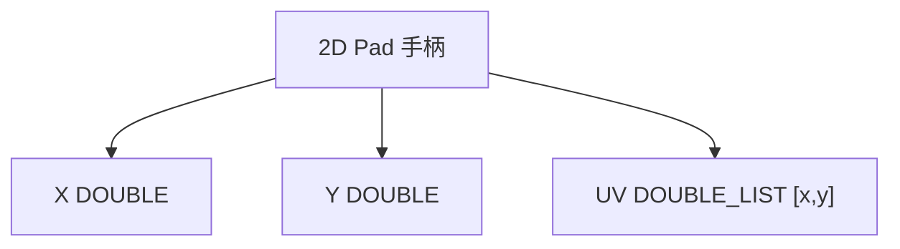

# XY Slider

| 字段 | 值 |
|---|---|
| 节点 ID | `input.numeric.xy_slider` |
| 分类 | `input.numeric` |
| 显示名称 | XY Slider |
| 效果 | `PURE` |

## 作用

二维拖动手柄，一次输出 X、Y，以及归一化 UV 列表。适合 2D 偏移、Gradient Ramp 的 X/Y 采样、平面内微调。



## 端点

### 输出

| 显示名 | 端口 ID | 类型 | 说明 |
|---|---|---|---|
| X | `output_x` | DOUBLE | 当前 X（在 MinX–MaxX） |
| Y | `output_y` | DOUBLE | 当前 Y（在 MinY–MaxY） |
| UV | `output_uv` | DOUBLE_LIST | 归一化对 `[x, y]` |

### 属性

| 属性 | 默认 | 说明 |
|---|---|---|
| X / Y | `0.5` / `0.5` | 当前值 |
| Min/Max X · Min/Max Y | `0`–`1` | 各轴范围 |
| Step | `0` | 吸附步进；0 关闭 |
| Precision | `2` | 显示小数位 |
| Y Axis Up | `true` | 垫上 Y 向上增大 |
| Show Value Inputs | `true` | 显示数字输入 |

## 使用步骤

1. 设好各轴 Min/Max（默认单位方）。
2. 在垫上拖动手柄，或输入 X/Y。
3. 分别接 X/Y，或把 UV 接到要成对坐标的下游。

## 典型接法

```text
[XY Slider].X ──► [Gradient Ramp].X
[XY Slider].Y ──► [Gradient Ramp].Y
[XY Slider].X ──► [构造点].X（配合另一数值）
```

## 注意事项

- UV 是归一化后的列表，具体归一化相对当前 Min/Max。
- Step > 0 时手柄会吸附到网格。
