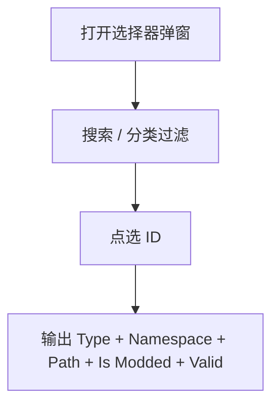

# input.type_selectors — 类型选择器

从 Minecraft 注册表里**搜索并选定**方块 / 实体 / 物品 / 生物群系 ID。四个节点共用同一套选择器 UI（搜索、分类、快捷项、Allow Modded）。

| 节点 | 教程 | 输出主类型 | 默认值 |
|---|---|---|---|
| Block Type Selector | [block_type_selector.md](./block_type_selector.md) | `BLOCK_TYPE` | `minecraft:stone` |
| Entity Type Selector | [entity_type_selector.md](./entity_type_selector.md) | `ENTITY_TYPE` | `minecraft:pig` |
| Item Type Selector | [item_type_selector.md](./item_type_selector.md) | `ITEM_TYPE` | `minecraft:stone` |
| Biome Selector | [biome_selector.md](./biome_selector.md) | `BIOME` | `minecraft:plains` |

进度见 [PROGRESS.md](../../PROGRESS.md)。
