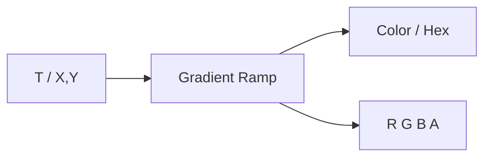

# Gradient Ramp

| 字段 | 值 |
|---|---|
| 节点 ID | `input.values.gradient_ramp` |
| 分类 | `input.values` |
| 显示名称 | Gradient Ramp |
| 效果 | `PURE` |

## 作用

带可视化编辑器的**多色标渐变**：按标量 T 或 2D (X,Y) 采样，输出颜色 / 通道 / Hex。最多 12 个 stop。常用于高度着色、沿路径变色、预览渐变条。



## 端点

### 输入

| 显示名 | 端口 ID | 类型 | 说明 |
|---|---|---|---|
| T | `input_t` | DOUBLE | 标量采样坐标；未连接默认 `0.5`；连了非法值则 fail-closed |
| X / Y | `input_x` / `input_y` | DOUBLE | 二维填充模式采样；未连接默认 `0.5` |

### 输出

| 显示名 | 端口 ID | 类型 | 说明 |
|---|---|---|---|
| Color | `output_color` | COLOR | 采样色 |
| R / G / B / A | `output_red` 等 | DOUBLE | 0–1 通道 |
| T | `output_t` | DOUBLE | 归一化后的采样坐标 |
| Hex | `output_hex` | STRING | `#RRGGBB` |
| Valid | `output_valid` | BOOLEAN | 输入与 stop 是否有效 |

### 主要模式（属性）

| 属性族 | 选项概要 |
|---|---|
| Gradient Mode | SCALAR / LINEAR / RADIAL / BOX / ANGULAR |
| Interpolation | LINEAR / SMOOTH / CONSTANT |
| Wrap | CLAMP / REPEAT / MIRROR |

## 使用步骤

1. 在节点 UI 里拖 stop、改颜色（默认三色：暗 → 青 → 黄）。
2. SCALAR 模式：把高度或归一化参数接到 **T**。
3. 二维填充模式：接 **X** / **Y**，并选对应 Gradient Mode。
4. 把 **Color** 或 **Hex** 接到预览 / 材质相关下游。

## 典型接法

```text
[归一化高度 0..1].Out ──► [Gradient Ramp].T
[Gradient Ramp].Color ──► [Preview / 着色节点].Color
```

## 注意事项

- 未连接的 T/X/Y 用默认 0.5；**一旦连接**却给非法值 → Valid false（不静默回退）。
- Stop 数量上限 12。
- Wrap / Interpolation 影响越界与色标之间的过渡，按视觉需求选。
