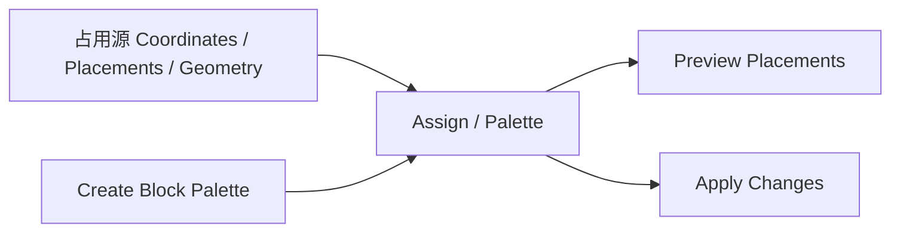

# material.basic_assignment — 基础赋材质

单方块、调色板创建与循环/加权空间赋值。多数映射只改 **blockId**，保留 **stateData**。

| 节点 | 教程 |
|---|---|
| Assign Block Type | [assign_block_type](./assign_block_type.md) |
| Create / Block / Weighted Palette | [create](./create_block_palette.md) · [block](./block_palette.md) · [weighted](./weighted_palette.md) |

