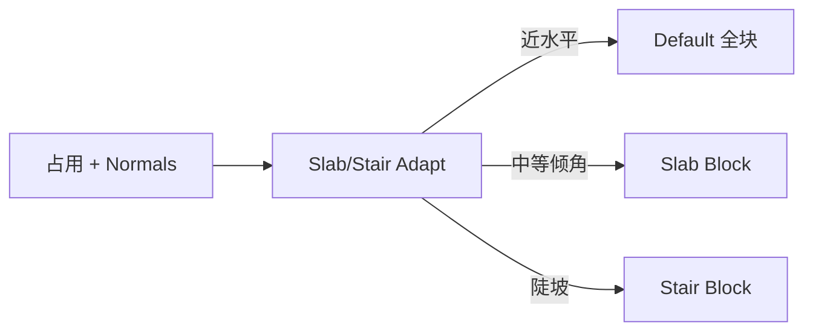

# Slab / Stair Adapt

| 字段 | 值 |
|---|---|
| 节点 ID | `material.directional_mapping.slab_stair_autofill` |
| 分类 | `material.directional_mapping` |
| 显示名称 | Slab / Stair Adapt |
| 效果 | `PURE` |

## 作用

按表面法线（相对竖直 abs(Y) 角）选 Default / Slab / Stair 方块类型。面板阈值：`[0, FullBlockMax]` 全块，`(FullBlockMax, StairMin]` 半砖，`(StairMin, 90]` 楼梯。

## 示意图



```text
  法线与竖直夹角 θ = acos(|Ny|)
  0° ──全块── θ1 ──半砖── θ2 ──楼梯── 90°
       FullBlockMax    StairMin
```

只改 blockId；楼梯朝向需另接 Orient / Stair Shape。

## 端点

| 方向 | 显示名 | 类型 |
|---|---|---|
| 入 | Block Placements / Coordinates / Geometry / Box·Cylinder·Sphere·Torus （占用源，按节点可选其一） / Normals / Default·Slab·Stair Block | … |
| 出 | Block Placements / Slab-Classified / Stair-Classified | … |
| 出 | Valid / Error | `output_valid` / `output_error` | BOOLEAN / STRING |

> 多数映射节点只改 **blockId**，保留已有 **stateData**。

## 使用步骤

1. 接入占用源（放置列表 / 坐标 / 几何之一）与材质参数。
2. 输出 Block Placements 接到 Preview 或 Apply Changes。

## 典型接法

```text
[上游].… ──► [Slab / Stair Adapt].Block Placements
[Slab / Stair Adapt].Block Placements ──► [下游].…
```
