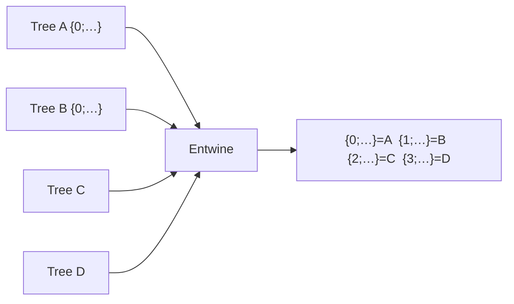

# Entwine

| 字段 | 值 |
|---|---|
| 节点 ID | `math.data_tree.entwine` |
| 分类 | `math.data_tree` |
| 显示名称 | Entwine |
| 效果 | `PURE` |

## 作用

最多四棵树挂到源索引路径前缀下（保留 T）。

## 示意图



```text
  A: {0}→[a1,a2]          结果:
  B: {0}→[b1]      Entwine  {0;0}→[a1,a2]
                            {1;0}→[b1]
```

源索引成为路径**最前一层**，便于按来源分支处理后再 Flatten / Graft。

## 端点

| 方向 | 显示名 | 类型 |
|---|---|---|
| 入 | A | DATA_TREE |
| 入 | B | DATA_TREE |
| 入 | C | DATA_TREE |
| 入 | D | DATA_TREE |
| 出 | Tree | DATA_TREE |
| 出 | Branch Count | INTEGER |
| 出 | Item Count | INTEGER |
| 出 | Valid | BOOLEAN |
| 出 | Error | STRING |

## 使用步骤

1. 接好所需输入（见端点表；可选端口可留空用面板默认）。
2. 执行/刷新图后查看主输出；若有 Valid/Error，先确认 Valid。

## 典型接法

```text
[上游].… ──► [Entwine].A
[Entwine].Tree ──► [下游].…
```
