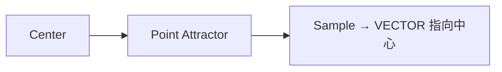

# Point Attractor Field

| 字段 | 值 |
|---|---|
| 节点 ID | `math.fields.point_attractor_field` |
| 分类 | `math.fields` |
| 显示名称 | Point Attractor Field |
| 效果 | `PURE` |

## 作用

拉向中心的吸引子场，可配距离衰减。

## 示意图



```text
      ● ←── ● ←── ●
       ╲         ╱
        ╲  ★C  ╱     距离 ↑ 则 |V| ↓（衰减）
        ╱       ╲
      ● ←── ● ←── ●
```

排斥用 [Repulsor](./repulsor_field.md) 反转；多源用 [Blend](./attractor_blend.md)。

## 端点

| 方向 | 显示名 | 类型 |
|---|---|---|
| 入 | Center | POINT |
| 入 | Strength | DOUBLE |
| 入 | Radius | DOUBLE |
| 入 | Exponent | DOUBLE |
| 出 | Field | VECTOR_FIELD |
| 出 | Valid | BOOLEAN |
| 出 | Error | STRING |

## 使用步骤

1. 接好所需输入（见端点表；可选端口可留空用面板默认）。
2. 执行/刷新图后查看主输出；若有 Valid/Error，先确认 Valid。

## 典型接法

```text
[上游].… ──► [Point Attractor Field].Center
[Point Attractor Field].Field ──► [下游].…
```
