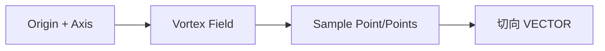

# Vortex Field

| 字段 | 值 |
|---|---|
| 节点 ID | `math.fields.vortex_field` |
| 分类 | `math.fields` |
| 显示名称 | Vortex Field |
| 效果 | `PURE` |

## 作用

绕轴的切向漩涡场，径向衰减与顺/逆时针。

## 示意图



```text
        ↻ Strength
     ╱─────╲
    │   ●轴  │   径向越远强度衰减
     ╲─────╱
  顺/逆时针由面板或轴向约定控制
```

可与吸引子 [Blend Vector Fields](./attractor_blend.md) 混合做涡流沉积。

## 端点

| 方向 | 显示名 | 类型 |
|---|---|---|
| 入 | Origin | POINT |
| 入 | Axis | VECTOR |
| 入 | Strength | DOUBLE |
| 入 | Radius | DOUBLE |
| 入 | Exponent | DOUBLE |
| 入 | Clockwise | BOOLEAN |
| 出 | Field | VECTOR_FIELD |
| 出 | Valid | BOOLEAN |
| 出 | Error | STRING |

## 使用步骤

1. 接好所需输入（见端点表；可选端口可留空用面板默认）。
2. 执行/刷新图后查看主输出；若有 Valid/Error，先确认 Valid。

## 典型接法

```text
[上游].… ──► [Vortex Field].Origin
[Vortex Field].Field ──► [下游].…
```
