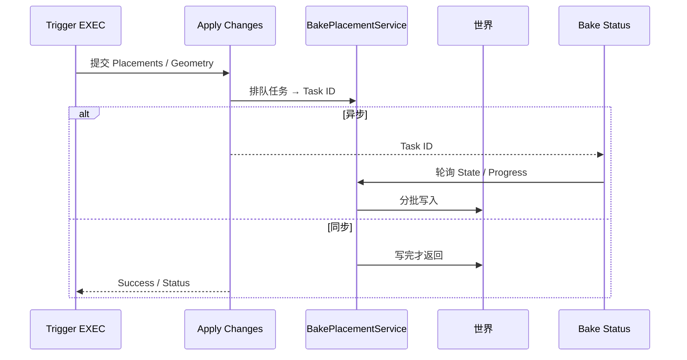

# Apply Changes

| 字段 | 值 |
|---|---|
| 节点 ID | `output.execute.apply_changes` |
| 分类 | `output.execute` |
| 显示名称 | Apply Changes |
| 效果 | `WORLD_WRITE` |

## 作用

把放置列表、放置树或体素化几何提交到世界。异步模式排队 bake 并返回 Task ID；同步模式等到终端状态。

## 示意图



异步时用 [Bake Status](./bake_status.md) 盯进度；取消用 [Cancel Bake](./cancel_bake.md)；撤销用 [Undo Last Change](./undo_last_bake.md)。

## 端点

| 方向 | 显示名 | 类型 |
|---|---|---|
| 入 | Trigger / Blocks / Geometry / 原语几何 / Block Type / Block Placements / Tree / Notify On Complete | EXEC / … |
| 出 | Success / Operation Count / Execution Time / Status / Task ID / Is Async | … |

## 使用步骤

1. 准备数据输入（放置/几何/坐标等）。
2. 用 EXEC/Trigger 触发（若有）；确认 Success / Status。
3. 需要时接 Undo 或 Bake Status 做收尾。

## 典型接法

```text
[Assign Block Type].Block Placements ──► Block Placements
[Manual Trigger].Exec ──► Trigger
[Apply].Task ID ──► [Bake Status].Task ID
```
