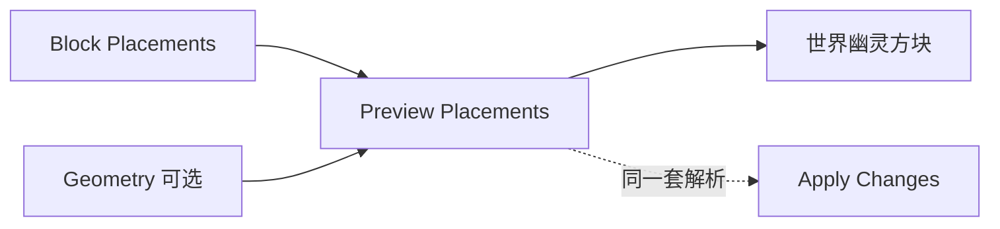

# Preview Placements

| 字段 | 值 |
|---|---|
| 节点 ID | `output.preview.preview_placements` |
| 分类 | `output.preview` |
| 显示名称 | Preview Placements |
| 效果 | `PREVIEW_WRITE` |

## 作用

按 Apply 的 PlacementSubmitPlan 做幽灵预览（完整 BlockState；放置优先于几何）。

## 示意图



```text
  有 Placements → 用完整 BlockState 预览（优先）
  仅 Geometry   → 按 Block Type 体素幽灵
  Geometry Ignored = 放置已接管时几何被忽略
```

清理用 [Clear Preview](../execute/clear_preview.md)；落盘仍需 Apply。

## 端点

| 方向 | 显示名 | 类型 |
|---|---|---|
| 入 | Block Placements / Tree / Blocks / Geometry / 原语 / Block Type | … |
| 出 | Success / Preview ID / Source / Raw·Unique·Shown Count / Sampled / Geometry Ignored / Error | … |

## 使用步骤

1. 接好查询/预览对象（区域、坐标、几何等）。
2. 运行后查看输出；预览类不写世界，清理用 Clear Preview。

## 典型接法

```text
[上游].… ──► [Preview Placements].Block Placements
[Preview Placements].Success ──► [下游].…
```
